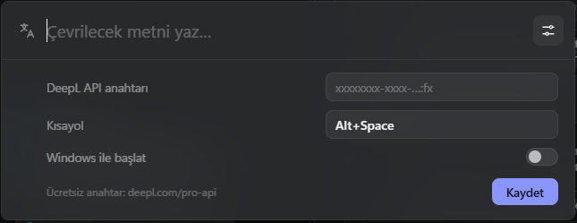

# QTranslate

Klavye kısayoluyla açılan, Spotlight tarzı küçük bir çeviri çubuğu. Yazdığın metni anında **DeepL** ile çevirir: Türkçe yazarsan İngilizceye, başka bir dilde yazarsan Türkçeye.



- **Tek kısayol:** Varsayılan kısayol `Alt+Space`. Ayarlardan istediğin kombinasyonu seçebilirsin.
- **Otomatik yön:** Dili kendisi algılar. "naber", "slm", "geliyorum" gibi kısa ve günlük Türkçeyi de tanır.
- **Hafif:** Uygulama yaklaşık 4 MB, kurulum dosyası 1,5 MB. Arka planda gizli bekler, boştayken işlemciyi kullanmaz.
- **Sade arayüz:** Windows 11 akrilik arka plan, açık ve koyu temayı otomatik takip eder.

> Yalnızca Windows 10 ve 11'de çalışır.

## İndir

[**Releases**](../../releases/latest) sayfasından iki dosyadan birini indir:

| Dosya | Açıklama |
| --- | --- |
| `QTranslate_x.y.z_x64-setup.exe` | Kurulum dosyası. Başlat menüsüne ekler ve kaldırılabilir. Yönetici izni istemez. |
| `QTranslate-portable.exe` | Kurulumsuz sürüm. İndir ve çift tıkla. |

**"Windows kişisel bilgisayarınızı korudu" uyarısı:** Uygulama kod imzası taşımadığı için Windows SmartScreen bu uyarıyı gösterebilir. **Ek bilgi → Yine de çalıştır** ile açabilirsin.

## İlk kurulum

1. Uygulamayı aç. İlk açılışta ayarlar paneli kendiliğinden gelir.
2. [deepl.com/pro-api](https://www.deepl.com/pro-api) adresinden ücretsiz bir **DeepL API Free** hesabı aç. Ücretsiz planda ayda 500.000 karakter çevirebilirsin.
3. Hesap sayfandaki API anahtarını kopyala. Ücretsiz anahtarlar `:fx` ile biter.
4. Anahtarı ayarlardaki alana yapıştırıp **Kaydet**'e bas.

Uygulama görev çubuğunda görünmez. Sistem tepsisindeki (saatin yanındaki) simgeden açabilir, ayarlara girebilir ya da kapatabilirsin.

## Kullanım

| Tuş | Ne yapar |
| --- | --- |
| `Alt+Space` | Çubuğu aç / kapat |
| Yazmak | Yazmayı bıraktığın anda çevirir |
| `Enter` | Hemen çevir |
| `Shift+Enter` | Yeni satır |
| `Tab` | Çeviri yönünü değiştir: Otomatik → TR→EN → Türkçeye |
| `Ctrl+Enter` | Çeviriyi kopyala ve kapat (çeviriye tıklamak da kopyalar) |
| `Esc` | Kapat |

Otomatik algılama yanılırsa `Tab`'a bas ya da sağ üstteki dil rozetine tıkla.

**Ayarlar** (çubuktaki ayar simgesi):

- DeepL API anahtarı
- Kısayol: Alana tıkla, yeni tuş kombinasyonuna bas.
- Windows ile başlat

Ayarlar `%APPDATA%\com.qtranslate.app\settings.json` dosyasında saklanır.

## Gizlilik

Yazdığın metin yalnızca çeviri için doğrudan DeepL'e gönderilir. Uygulama başka hiçbir sunucuya bağlanmaz ve veri toplamaz. API anahtarın sadece senin bilgisayarında saklanır.

## Geliştirme

[Tauri 2](https://tauri.app) (Rust) ve vanilla TypeScript ile yazıldı.

**Gerekenler:**

- [Node.js](https://nodejs.org) 20+
- [Rust](https://rustup.rs)
- [Visual Studio Build Tools](https://visualstudio.microsoft.com/visual-cpp-build-tools/), "Desktop development with C++" iş yüküyle

```bash
npm install
npm run tauri dev     # geliştirme modunda çalıştır
npm run tauri build   # kurulum dosyasını üret
```

`npm run tauri build` iki çıktı üretir:

- Kurulum dosyası: `src-tauri/target/release/bundle/nsis/`
- Kurulumsuz exe: `src-tauri/target/release/QTranslate.exe`

Testler:

```bash
cd src-tauri && cargo test
```

### Proje yapısı

```
index.html, src/          Arayüz (arama çubuğu, ayarlar)
src-tauri/src/main.rs     Pencere, tepsi simgesi, komutlar
src-tauri/src/translate.rs  DeepL istemcisi ve dil yönü algılama
src-tauri/src/shortcut.rs   Global kısayol yönetimi
src-tauri/src/settings.rs   Ayarların saklanması
```

### Yeni sürüm yayınlama

`v` ile başlayan bir etiket gönderdiğinde GitHub Actions uygulamayı derler. Kurulum dosyasını ve taşınabilir exe'yi otomatik olarak Releases'a yükler:

```bash
git tag v0.1.0
git push origin v0.1.0
```

Etiketi göndermeden önce `src-tauri/tauri.conf.json` ve `package.json` içindeki sürüm numarasını güncelle.
